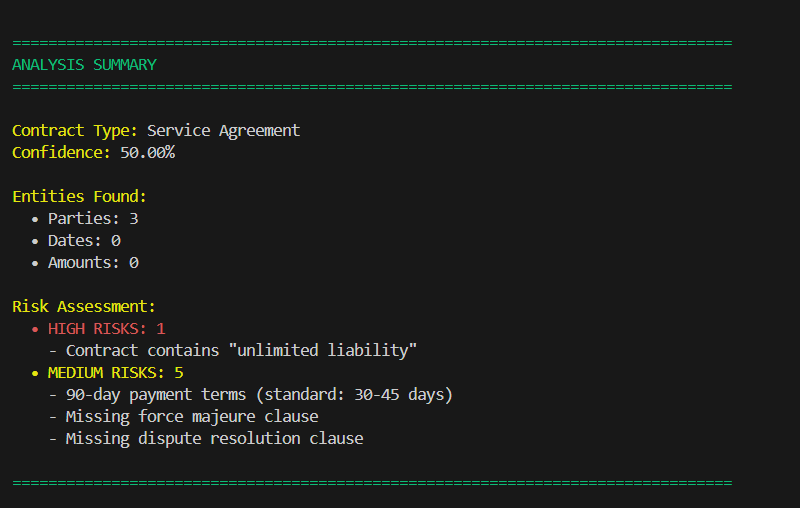
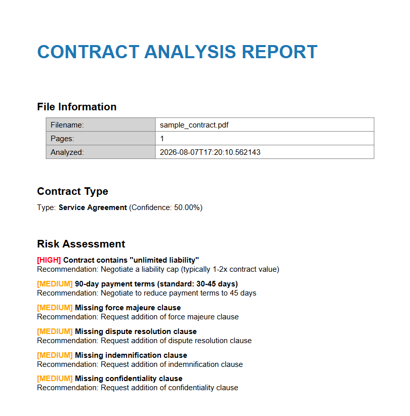
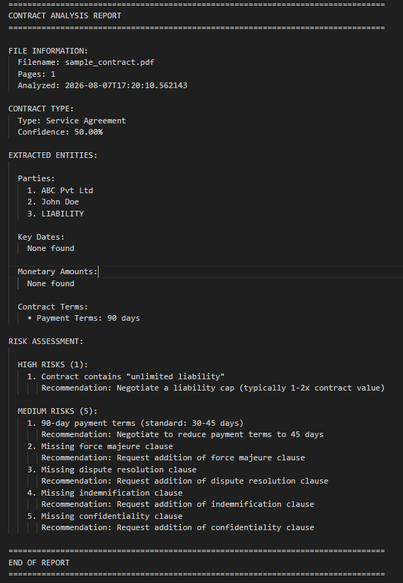

# Contract Analyzer

A Python application that analyzes PDF contracts and generates structured reports. The project extracts important information from contracts, classifies the contract type, checks for predefined legal risks, and produces reports in JSON, text, and PDF formats.

This project was built as part of a university software engineering project to learn how natural language processing and rule based systems can be applied to legal documents.


---

# Features

- Extracts text from PDF contracts
- Cleans and normalizes extracted text
- Classifies contract types
- Extracts important contract information including:
  - Parties
  - Dates
  - Monetary amounts
  - Email addresses
  - Contract terms
- Detects predefined legal risks
- Generates reports in JSON, TXT, and PDF formats
- Uses a modular pipeline that separates extraction, analysis, and reporting

---

# Project Architecture

```text
                PDF Contract
                     │
                     ▼
             PDF Text Extractor
                     │
                     ▼
               Text Cleaner
                     │
                     ▼
            Entity Extractor
                     │
                     ▼
          Contract Classifier
                     │
                     ▼
             Risk Detector
                     │
                     ▼
            Report Generator
             ├── JSON
             ├── TXT
             └── PDF
```

---

# Installation

Clone the repository.

```bash
git clone https://github.com/NeilGehlot/Contract-Analyzer.git

cd Contract-Analyzer
```

Create a virtual environment.

```bash
python -m venv venv
```

Activate the environment.

### Windows

```powershell
venv\Scripts\activate
```

### Linux / macOS

```bash
source venv/bin/activate
```

Install the required packages.

```bash
pip install -r requirements.txt
```

Download the spaCy language model.

```bash
python -m spacy download en_core_web_sm
```

---

# Running the Project

Analyze a contract.

```bash
python run_analyzer.py "data/raw/sampleNDA.pdf"
```

Generate only the JSON report.

```bash
python run_analyzer.py "data/raw/sampleNDA.pdf" --json-only
```

Skip PDF report generation.

```bash
python run_analyzer.py "data/raw/sampleNDA.pdf" --no-pdf
```

Specify a custom output directory.

```bash
python run_analyzer.py "data/raw/sampleNDA.pdf" --output-dir outputs/custom_reports
```

---

# Example Output

## Terminal Output


---

## PDF Report


---

## Text Report


---

# How the Pipeline Works

### 1. PDF Extraction

The application first attempts to extract text using **pdfplumber**. If that fails, it automatically falls back to **PyPDF2**.

---

### 2. Text Cleaning

The extracted text is cleaned before further processing.

The cleaning stage removes:

- Page numbers
- Confidentiality headers
- Extra whitespace
- Unsupported characters

Currency values are also normalized.

---

### 3. Entity Extraction

The cleaned text is processed using a combination of spaCy and regular expressions.

The application extracts:

- Parties
- Dates
- Monetary amounts
- Email addresses
- Contract terms

---

### 4. Contract Classification

A simple keyword based scoring approach is used to estimate the contract type.

Currently supported contract types include:

- NDA
- Employment Agreement
- Service Agreement
- Vendor Agreement
- Consulting Agreement
- Lease Agreement
- Partnership Agreement
- Sales Agreement

---

### 5. Risk Detection

The extracted information is compared against configurable rules stored in `config.yaml`.

The current implementation checks for:

- Unlimited liability clauses
- Missing contractual clauses
- Long payment terms
- Potentially unfair contract terms

Each detected issue includes a description and a suggested recommendation.

---

### 6. Report Generation

The final analysis is exported in three formats.

- JSON
- Plain text
- PDF

Each report contains:

- Contract information
- Classification results
- Extracted entities
- Detected risks
- Suggested recommendations

---

# Technologies Used

| Category | Tools |
|----------|-------|
| Programming Language | Python |
| NLP | spaCy |
| PDF Processing | pdfplumber, PyPDF2 |
| Report Generation | ReportLab |
| Configuration | YAML |
| Text Processing | Regular Expressions |
| Logging | Python logging |

---

# Current Limitations

This project was developed as a learning exercise and has a few limitations.

- The classifier uses keyword matching instead of a machine learning model.
- Risk detection is based on predefined rules.
- Only English language contracts are supported.
- Scanned PDFs that require OCR are not currently supported.
- The application is intended for educational purposes and should not be used as a substitute for professional legal review.

---

# Possible Future Improvements

Some ideas for extending the project include:

- Machine learning based contract classification
- Legal-BERT based clause analysis
- OCR support for scanned documents
- Semantic similarity search for clauses
- Risk scoring based on context
- Web interface using Streamlit or FastAPI
- Docker support
- REST API integration

---

# License

This project is released under the MIT License.

See the LICENSE file for more information.

---

# Author

**Neil Gehlot**

B.Tech Data Science Engineering  
Manipal University Jaipur

LinkedIn: https://linkedin.com/in/neilgehlot